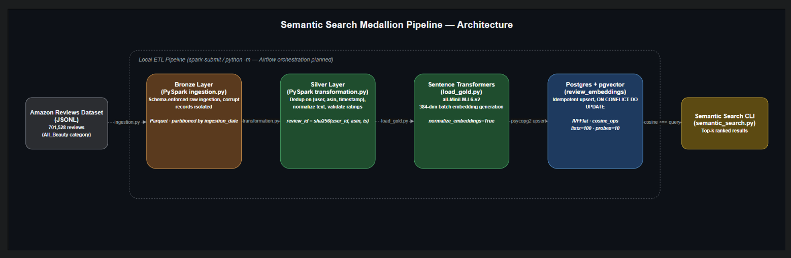
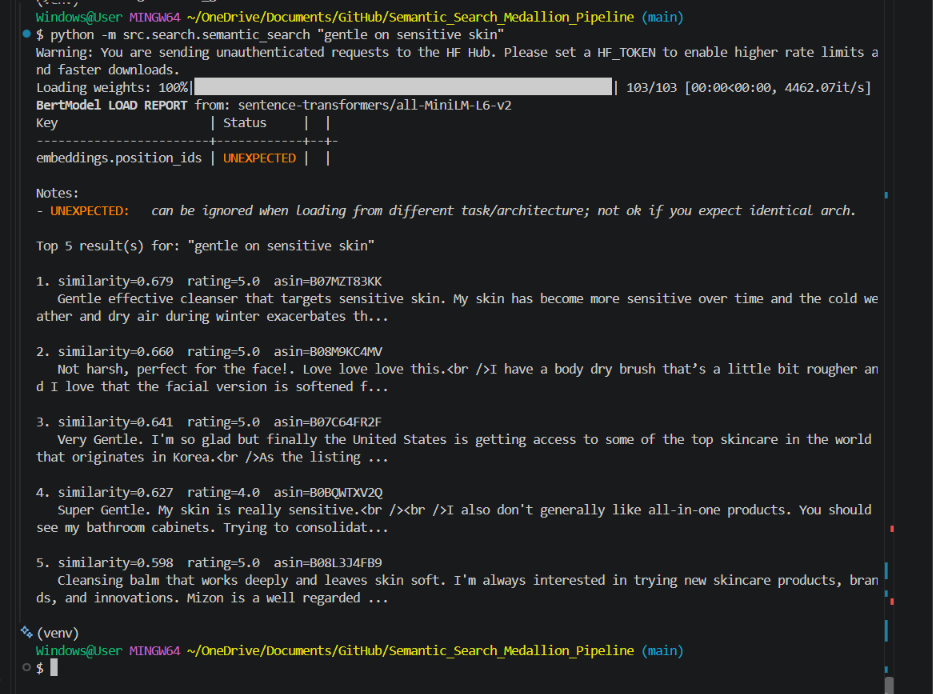
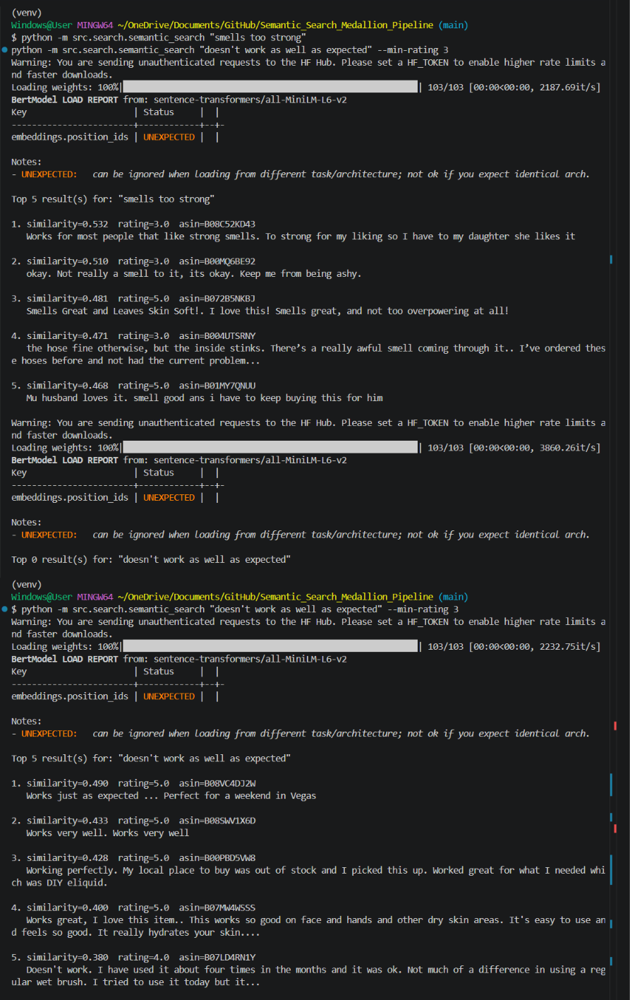

# 🔎 Semantic Search Medallion Pipeline

Production-grade Medallion data pipeline for semantic search. Ingests unstructured Amazon review data with PySpark, transforms it through Bronze–Silver–Gold layers, and generates embeddings using Sentence Transformers. Stores vectors in PostgreSQL (pgvector) for scalable similarity search and AI-ready analytics.

## 📖 Overview

Most of the medallion pipelines in a data engineering portfolio end at "curated table ready for a BI dashboard." This one goes a step further: the Gold layer isn't a set of aggregated metrics, it's a vector index — the review text itself becomes queryable by *meaning*, not just by keyword.

Given a query like `"battery drains too fast"`, the search layer returns the most semantically similar reviews even if they never use the words "battery" or "drains" — e.g. a review saying *"doesn't hold a charge past lunchtime"* ranks highly because its embedding sits close to the query's in vector space.

## 🏗️ Solution Architecture



```
Amazon Reviews (JSONL)
        │
        ▼
Bronze Layer  (PySpark)
Schema-enforced raw ingestion, partitioned by ingestion date
        │
        ▼
Silver Layer  (PySpark)
Dedup, text normalization, timestamp coercion, title+body merge
        │
        ▼
Gold Layer  (Sentence Transformers + psycopg2)
Batch embedding generation → upsert into Postgres (pgvector)
        │
        ▼
Search Layer  (CLI)
Query embedding → cosine similarity search via pgvector `<=>` operator
```

## 🚀 Key Features

- Schema-enforced Bronze ingestion with corrupt-record isolation (bad rows are counted and dropped, not silently lost)
- Silver-layer dedup on `(user_id, asin, timestamp)`, text normalization, and rating-range validation
- Batch embedding generation with `sentence-transformers` (`all-MiniLM-L6-v2` by default, 384-dim)
- Idempotent Gold-layer upserts (`ON CONFLICT DO UPDATE`) so re-runs don't duplicate rows
- IVFFlat cosine-similarity index in pgvector for approximate nearest-neighbour search at scale
- A working CLI search interface with an optional minimum-rating filter — the actual "search" the project's name promises

## 🛠️ Technology Stack

| Category | Technology |
|---|---|
| Distributed processing | Apache Spark (PySpark) |
| Embedding model | Sentence Transformers (`all-MiniLM-L6-v2`) |
| Vector storage & search | PostgreSQL + pgvector |
| Data format | JSONL (raw), Parquet (bronze/silver) |
| Containerization | Docker & Docker Compose |
| Testing | pytest |

## 🏛️ Architecture Layers

### 🥉 Bronze Layer — Raw Ingestion
`src/bronze/ingestion.py`
Reads raw Amazon review JSONL with an enforced schema, isolates unparseable records instead of dropping them silently, and lands the result as Parquet partitioned by ingestion date.

### 🥈 Silver Layer — Cleaning & Normalization
`src/silver/transformation.py`
Deduplicates on `(user_id, asin, timestamp)`, normalizes whitespace, validates the 1.0–5.0 rating range, coerces the epoch timestamp to a real timestamp, and merges title + body into a single `review_text` field — the exact text that gets embedded downstream.

### 🥇 Gold Layer — Embeddings & Vector Storage
`src/gold/load_gold.py`
Batches the silver data through a Sentence Transformer model and upserts `(review_id, ..., embedding)` rows into Postgres. Creates the `vector` extension, table, and IVFFlat index on first run if they don't already exist.

### 🔍 Search Layer — Querying
`src/search/semantic_search.py`
Embeds a natural-language query with the same model used at load time (critical — a query embedded with a different model than the corpus won't compare meaningfully) and returns the top-k nearest reviews by cosine similarity.

## 🏁 Getting Started

### 1. Start Postgres with pgvector

```bash
docker compose up -d
```

### 2. Install dependencies

```bash
python -m venv .venv && source .venv/bin/activate
pip install -r requirements.txt
cp .env.example .env   # adjust if you changed any defaults
```

### 3. Add raw data

Download a category from the [Amazon Reviews 2023 dataset](https://amazon-reviews-2023.github.io/) (or any JSONL file matching the schema in `src/bronze/ingestion.py`) into `data/raw/`.

### 4. Run the pipeline

```bash
spark-submit src/bronze/ingestion.py
spark-submit src/silver/transformation.py
python -m src.gold.load_gold
```

### 5. Search

```bash
python -m src.search.semantic_search "battery life disappointing" --top-k 5
python -m src.search.semantic_search "great gift for a teenager" --min-rating 4
```

### 6. Run tests

```bash
pytest tests/
```

## 🧪 Search in Action

### Semantically relevant results, not just keyword matches

Query: `"gentle on sensitive skin"` — every result is genuinely about gentle/sensitive-skin products, ranked by similarity, even though none of them repeat the query's exact wording:



### Finding and fixing a real recall bug

Filtering by `--min-rating 3` on `"doesn't work as well as expected"` first returned **zero results** — not because no qualifying reviews existed, but because pgvector's IVFFlat index only scans 1 of its 100 clusters per query by default (`probes=1`). On a small table, that's a narrow enough window that a rating filter can legitimately come up empty. Raising `ivfflat.probes` to 10 fixed it — the same query then returned five relevant, correctly-filtered results:



### A known limitation worth naming

Sentence embeddings capture *topic* far better than *sentiment*. Querying `"smells too strong"` surfaces reviews about scent intensity generally — including a couple of positive reviews saying a product is *not* overpowering. The model correctly identifies these as topically similar; it just can't reliably tell "too strong" apart from "not too strong" on its own. Hybrid keyword + semantic search (listed below) is the real fix for this, not a bigger model.

## 📈 Future Enhancements

- Incremental Bronze ingestion (watermark on `timestamp` instead of full reloads)
- Hybrid search: combine pgvector cosine similarity with Postgres full-text search (`ts_rank`) for keyword + semantic blending
- Swap `all-MiniLM-L6-v2` for a larger model behind a config flag and benchmark recall vs. latency
- Airflow DAG to orchestrate all four stages on a schedule
- A small Streamlit front end over `semantic_search.py` for a live demo

## 👨‍💻 Author

### Miracle Osabuogbe

#### Cloud Data Engineer | Azure Data Engineer | Data Analytics Engineer

**Core Skills:** Python, SQL, Apache Spark, Apache Airflow, PostgreSQL, Docker, Sentence Transformers, pgvector
